# Pacepact

A running tracker for race goals, a simple repeating plan, and groups.
Set a race and target time, log runs by hand or import them automatically,
and train together with friends.

**Live:** https://pacepact.maximilianauer.at · **Version:** 0.2.0

| Crew | Crew stats | Me | Log a run |
| ---- | ---------- | -- | --------- |
| 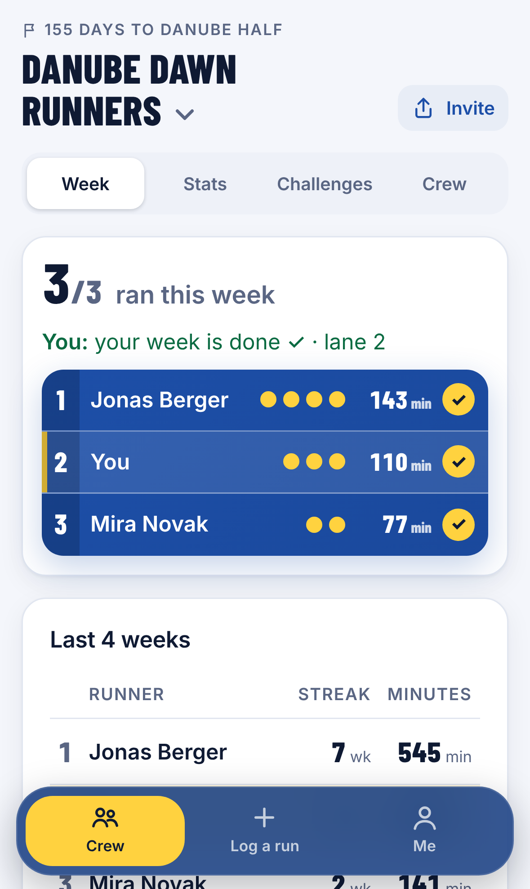 | 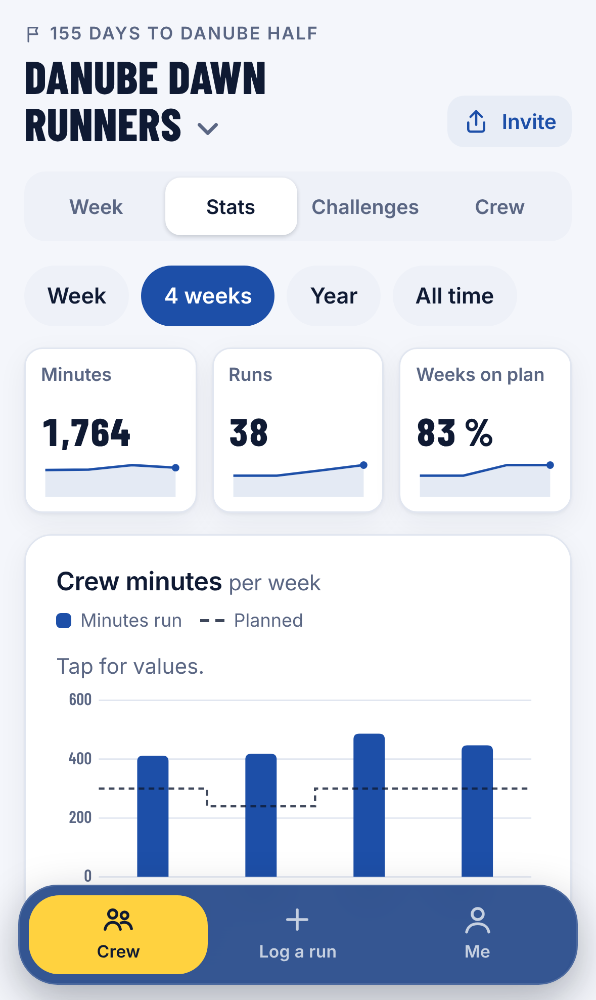 | 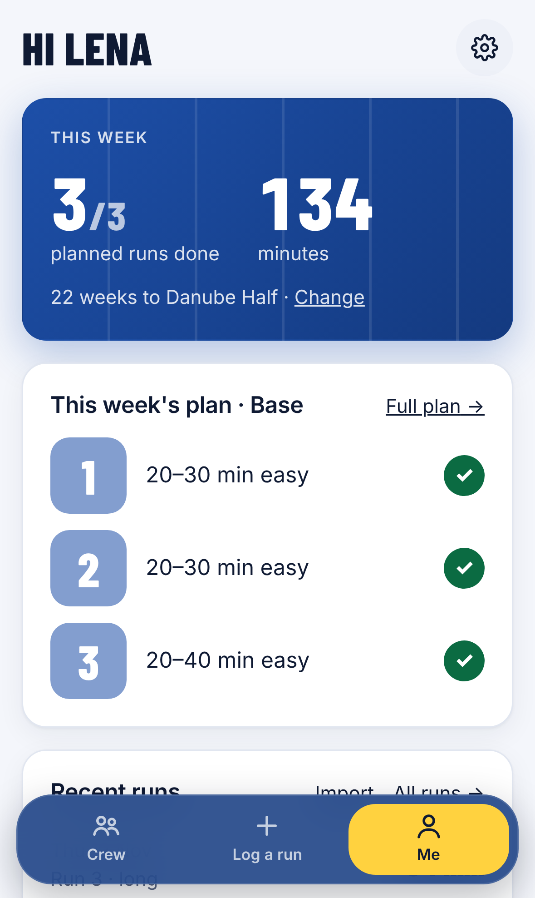 | 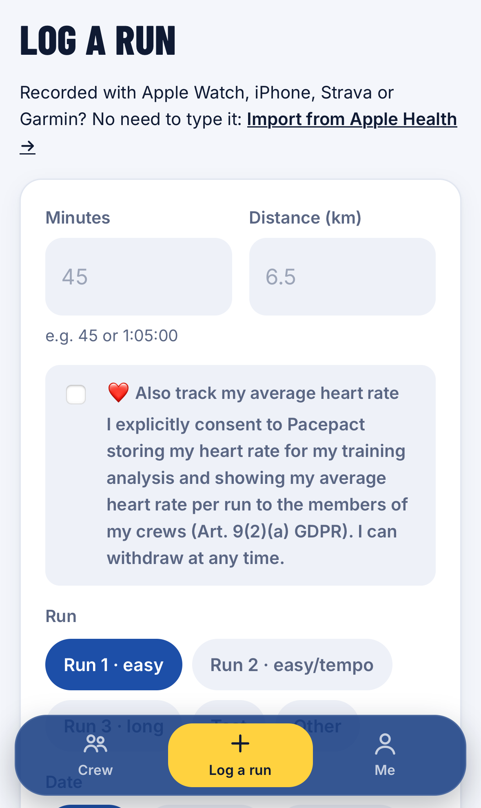 |
| 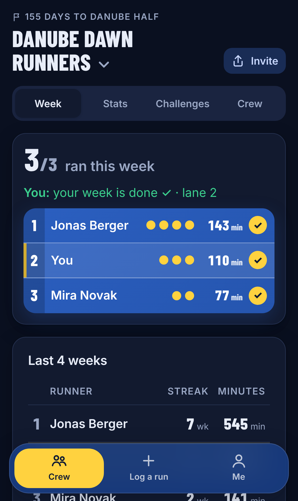 | 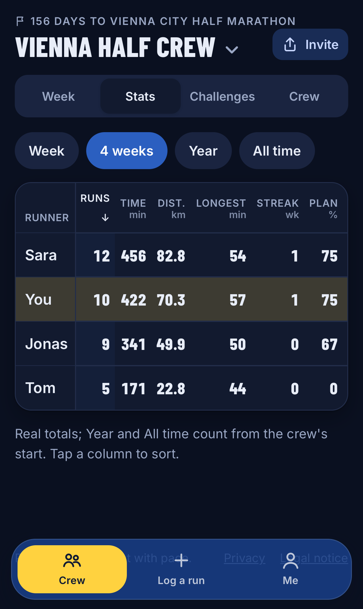 | 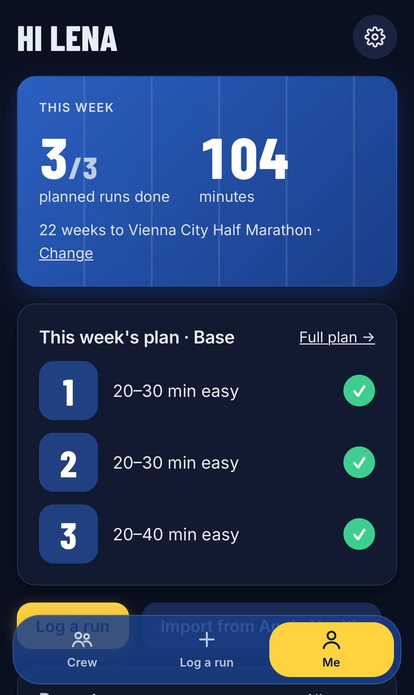 | 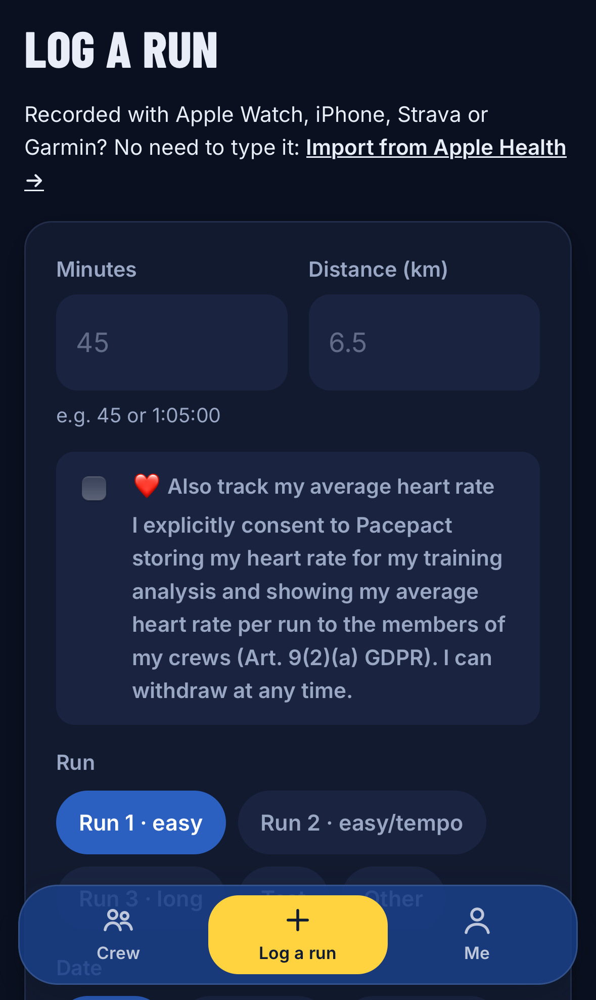 |

**Desktop**

| Light | Dark |
| ----- | ---- |
| 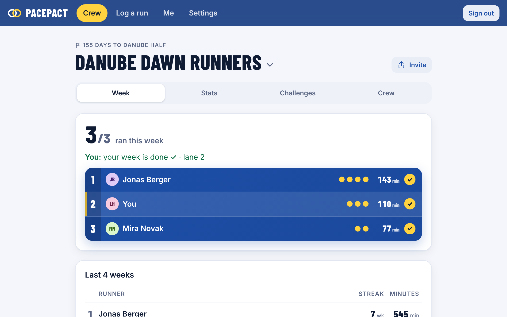 | 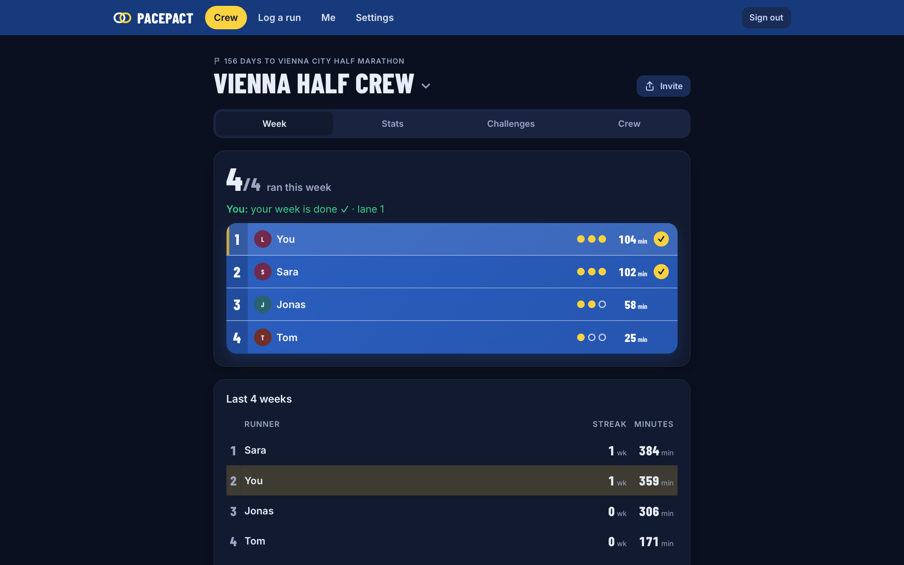 |
| 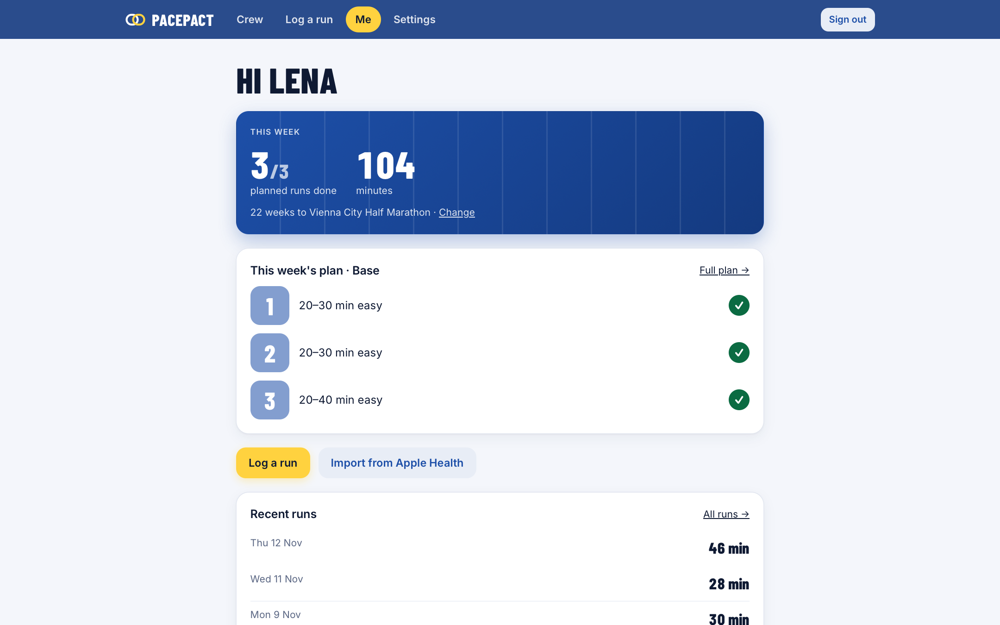 | 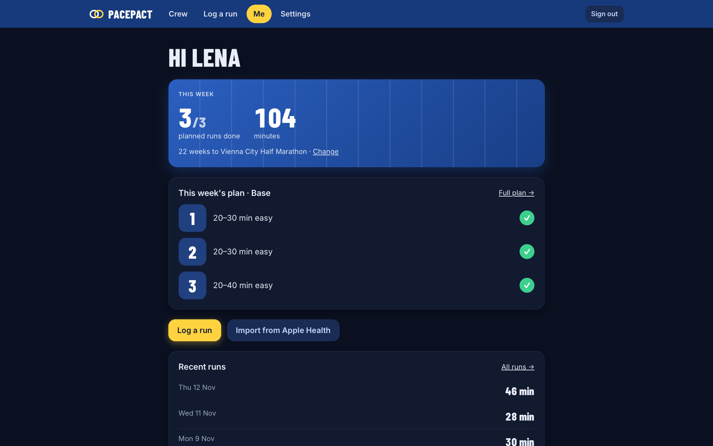 |

Screenshots show a sample crew with invented names from a local test instance, not real runners.

## Features

- **Accounts:** open sign-up with passkeys only (Face ID, Touch ID, Windows Hello, phone). No email, no password.
  Users can add more passkeys in Settings.
- **Welcome flow:** four questions after sign-up (goal and date, starting point, runs per week, strength training)
  that set up the plan; single-choice answers move on with one tap, and invited runners get the crew's race prefilled.
  It can be repeated from Settings.
- **Install as app:** web app manifest and icons; Android/Chrome gets a real install button, iPhone/iPad a short
  "Share → Add to Home Screen" guide (as in Rookie).
- **Navigation:** three places only: Crew (opens the crew you looked at last, remembered in the `pp_crew` cookie; switch
  crews with the arrow next to the crew name, which also leads to starting or joining another crew), Log a run (+) and Me (my week against the plan, recent runs, links to
  the full plan, all runs, Apple Health import and personal challenges). Settings sit behind the gear icon.
- **Speed:** every tap answers at once: the tab bar, crew tabs, statistics periods and sort columns mark the tapped
  item immediately and dim the old content until the server answers (`src/app/instant.tsx`); kudos count up
  optimistically (`useOptimistic`, reducer in `src/lib/social/kudos.ts`). Lists stay light: the runs list shows 30 rows
  (one link each, editing on `/runs/[id]`), the crew feed 15 items, both with "show more" (`src/lib/paging.ts`).
  The crew page loads its data in parallel waves and writes "last seen" after the response (`after()`).
- **App chrome:** on phones there is no header (tab bar only; settings on Me; sub-pages have a back link); header and tab bar live in the shared layout of the `src/app/(app)` route group, so they stay put
  between pages and the tapped tab lights up at once; `(app)/loading.tsx` shows a skeleton while a page renders.
  Which tab is active comes from `sectionOf` in `src/lib/nav.ts`.
- **No dropdowns:** choices are tap chips (run type, date, walk breaks, race registration, language, distance,
  challenge opponent). The date is Today / Yesterday / 2 days ago in the device's own calendar, or any other date.
- **Log a run:** minutes and km are the only required fields; average heart rate is a standard field for runners who
  consented to storing heart rate; others can give that consent right in the form with a separate, unticked checkbox
  (the field appears only once it is ticked). The Me page shows "pace at the same heart rate" (12 weeks, ±5 bpm around
  the typical average heart rate, `hrTrend` in `src/lib/stats.ts`), visible only to the runner. The run type is
  preselected (the next open planned run); time, max heart rate, effort, walk breaks and notes are under "More details". After saving, the runner lands in their crew.
- **Languages:** English by default, German selectable in the intro (landing, sign-up, invite) and in Settings, saved per account.
- **Goals:** race, date, distance and optional target time. The required pace and a countdown in weeks are calculated.
- **Plan:** Run 1 (easy), Run 2 (easy, later tempo) and Run 3 (long run), with no fixed weekdays. Two runs a week drop
  Run 2; four add an easy Run 4. Phases are counted back from race day.
  Tempo work in Run 2 unlocks after a logged easy (effort ≤ 6) 30-minute run known to be without walk breaks or, until
  then, based on the runner's own statement in the welcome flow (shown as "reported", not "measured"). Never because of
  the calendar. Apple Health imports cannot tell walk breaks apart (`walk_known = false`); runners can confirm "no walk breaks"
  per run in the runs list.
  Every fourth week is lighter (about a quarter fewer minutes, one tempo repetition less); in race week the race
  replaces the long run.
- **Runs come in two ways only:**
  - **By hand:** date, time, type, distance, duration, effort 1–10, walk breaks, notes (heart rate with consent).
  - **Apple Health export:** in the Health app "Export All Health Data" → save export.zip to Files → choose it on
    `/import`. The browser unzips and scans export.xml as a stream (`fflate`, `src/lib/import/apple-export.ts`, works
    with multi-gigabyte exports) and uploads only running workouts in batches of 100 to `/api/import/apple-health`.
    The export never leaves the phone. Every app that writes to Apple Health counts (Apple Watch, iPhone, Strava,
    Garmin Connect, Nike Run Club, …). For new runs, repeat the export now and then; duplicates are skipped.
  - The same run typed in and imported is merged (`src/lib/dedupe.ts`): the imported copy wins, and effort, notes and
    run type typed by the runner are kept.
- **Crews (groups) – the heart of the app:** signed-in runners land in their crew.
  - Invite link `/join/<code>` with the system share sheet; new runners sign up and land in the crew after the welcome
    flow (9 taps including the passkey prompt; 11 taps and 3 fields until they see their first run in the lanes). Admins rotate the code, remove members, edit the crew (race countdown, "count only Apple Health runs")
    and delete it; everyone can leave.
  - The crew home answers two questions without scrolling on a phone: who ran this week ("3/4 ran this week", one
    lane per runner with planned runs as dots, minutes and a check mark) and where do I stand ("You: 1 run to go ·
    lane 2"). Below it, one fair four-week comparison: streak (weeks in a row on plan), then minutes.
    Minutes count only up to the plan + 10 % per week; weeks before a runner's first run do not count as missed; raw
    pace and heart rate are never ranked. Logic: `src/lib/social/overview.ts`.
  - Stats tab: real totals per runner for Week / 4 weeks / Year / All time (Year and All time count from the crew's
    start), sortable by runs, minutes, distance, longest run, streak and share of plan weeks done. Distance only for
    runners who share it (hidden values always sort last); never pace. Logic: `crewStats` in `src/lib/social/overview.ts`.
  - Challenges in seconds: three templates up front (1,500 minutes together, 4 weeks on plan, minutes duel), more
    templates and a custom form one tap away: together (e.g. 200 km), everyone (e.g. most runs, 4 weeks on plan,
    5/10 km test), 1:1 duels with accept/decline, and personal ones (30 minutes without walking, long run +10 %).
    They never reward more than the plan. Results, stickers and a recap when they end.
  - Feed (runs since joining, milestones, finished challenges) with kudos, comments, reporting and admin moderation;
    "since your last visit" hints. Crew rules at `/rules`.
  - Visibility in a crew: minutes, run type, distance, pace and plan progress are always visible. Average heart rate is
    visible for runners whose heart-rate consent covers crews (`src/lib/hr.ts`; consents from before 2026-11-13 are
    asked to confirm the new wording). Never notes, goals or maximum heart rate. Apple Health runs are marked as such; manual entries as self-reported.
- **Design:** "Bahn" (blue tartan track, lane numbers, condensed race numerals), light and dark mode, works on phones.
  Condensed caps only for page titles and numbers; section titles in Inter, sentence case. Soft cards (18 px radius,
  light shadows), tinted secondary buttons, tap chips, gentle fade-in of new content (off with reduced motion).
  Text contrast is WCAG AA in light and dark.

Strava, the personal API, Health Auto Export, Apple Shortcuts and GPX/TCX/FIT/CSV files were removed on 2026-11-12:
Apple Health covers every watch and app, and the web cannot read Apple Health directly (see `docs/legal/drittanbieter.md`).

## Deployment (Cloudflare)

One-time setup:

1. `npx wrangler login`
2. Create the database in the EU: `npx wrangler d1 create pacepact --jurisdiction eu`.
   Put the printed `database_id` into `wrangler.jsonc`.
3. Apply migrations: `npm run db:migrate:remote`
4. Deploy: `npm run deploy`. The route in `wrangler.jsonc` attaches `pacepact.maximilianauer.at` as a custom domain;
   because `maximilianauer.at` is on Cloudflare, DNS and HTTPS are set up automatically.

Afterwards, every `npm run deploy` publishes a new version.

Automatic deploys (set up for production): Cloudflare dashboard → Workers & Pages → `pacepact` → Settings → Builds →
Connect → repository `gitmaximilian/pacepact`, branch `main`, build command `npm run build` (runs the OpenNext
build), deploy command `npx wrangler deploy` (Cloudflare's defaults). Every push to `main` then goes live.
GitHub Actions only runs type check, tests and a build (`.github/workflows/ci.yml`). Database migrations are not
applied by the build; run `npm run db:migrate:remote` before pushing a schema change.

Plan note: Pacepact is built for the Workers Free plan (10 ms CPU per request). Sign-in uses passkeys, whose
verification is cheap; page rendering measured around 10 ms locally, so occasional CPU-limit errors (1102) are
possible on Free. If they happen, Workers Paid removes the limit without code changes.

Local preview note: because `wrangler.jsonc` has a custom-domain route, run the local Worker with
`npx wrangler dev --local-upstream localhost:8787` so the Origin check of the passkey API sees the local address.

## Configuration

No secrets are needed. `APP_URL` is set in `wrangler.jsonc` (see `.env.example` for local runs).

## Privacy and security

- Sign-in: passkeys (WebAuthn) only; the server stores public keys, one-time challenges expire after 5 minutes.
  Sessions: random tokens, stored only as SHA-256 hashes.
- The passkey API checks the Origin header. Sign-in, sign-up, joining, invite links, comments, kudos, challenge
  creation and imports are rate-limited in D1 (`rate_limits`, hashed keys, shared by all Worker instances).
- Implausible runs (faster than 2:30 min/km) are rejected when typed in and never count in crews.
- Users can delete their account and all data under Settings. Groups they own are handed to another member.
- Heart rate is health data (Art. 9 GDPR). It is only stored with explicit, separate consent; without consent,
  heart-rate values are dropped before saving. Withdrawing consent deletes all stored heart rates.
- Sign-up requires confirming a minimum age of 14 (Austria, § 4 (4) DSG) and having read the privacy notice.
  No email address is collected.
- Users can download all their data as JSON (`/api/export`). Accounts unused for two years are deleted automatically.
- Apple Health: the export is processed in the browser; only running workouts (time, duration, distance, heart rate
  with consent) are sent to the server.
- Crew pages read precomputed weekly totals (`run_weeks`), rebuilt when runs change, to stay within the Workers free
  plan's CPU limit. Bump `STATS_VERSION` in `src/lib/social/store.ts` when the formulas change.
- The in-app privacy notice is at `/privacy` (English and German). Its facts come from `src/lib/legal.ts`.
  It describes the hosting on Cloudflare (Workers and D1, EU). Update that file if the hosting changes.
- Internal GDPR documents (German) are in `docs/legal/`: record of processing activities, technical and organisational
  measures, data breach procedure, DPIA threshold assessment, third-party API checklist and a section for the
  privacy policy on maximilianauer.at.

## License

Not chosen yet.
